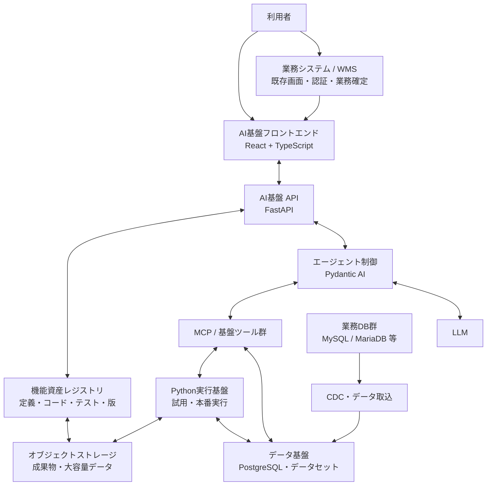
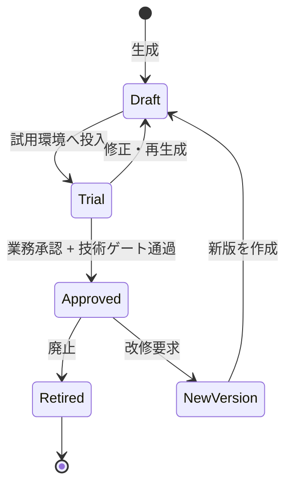
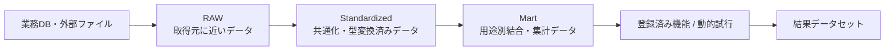
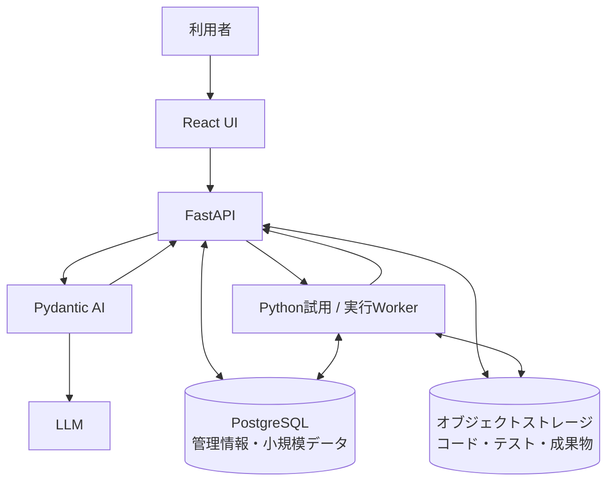

# AI実行基盤：構想整理と実現ロードマップ

- **版**：1.0
- **整理日**：2026-11-16
- **目的**：これまでの検討内容から、AI実行基盤を実現するための中核となる考え方、前提、構成、設計方針、実装順序を整理する
- **位置付け**：構想・設計の基準資料。製品バージョン、接続方式、運用値など、PoCや実環境検証が必要な項目は「要検証」として扱う

---

## 1. この基盤で実現すること

本基盤は、業務システムに生成AIチャットを追加するだけの仕組みではない。ユーザーが自然言語で依頼した処理を、AIエージェントがデータや業務知識を調査しながら動的に組み立て、結果を試用・評価したうえで、**再現可能な通常プログラムとして登録し、次回以降はLLMを介さずに実行できるようにする基盤**である。

中心となる考え方は、次の一連の流れにある。

1. ユーザーが実現したいことを自然言語で依頼する。
2. AIエージェントが利用可能なデータセット、データ構造、処理手段を調査する。
3. LLMが処理方針を考え、SQLやPython等で実現方法を構築する。
4. 隔離された試用環境で実行し、結果・性能・妥当性を確認する。
5. ユーザーが業務上の利用価値を判断し、承認する。
6. 処理定義、入出力契約、ソースコード、依存関係、テストを一体の機能資産として登録する。
7. 通常運用では、登録済みの固定バージョンを通常のプログラムとして実行する。

この資料では、この特徴を **「LLMによる動的処理の静的機能化」** と呼ぶ。

### 1.1 基本方針

| 方針 | 意味 |
|---|---|
| LLMは主に構築時に使う | 要求解釈、データ調査、処理設計、コード生成、修正に使う |
| 通常実行時はLLMを介さない | 承認済みのプログラムを、決められた入力と権限で実行する |
| 実行履歴をそのまま機能化しない | 履歴を参考情報として、再利用可能な仕様・コード・テストに再構成する |
| 業務上の承認と技術的な安全判定を分離する | ユーザー承認は利用価値の判断。実行許可は基盤の自動検査・権限制御で決める |
| 個別ロジックは無理に汎用化しない | 共通化するのは主に呼び出し方、入出力契約、実行・管理の仕組み |
| 機能資産はバージョン固定する | 稼働中の成果物を直接変更せず、変更は新しいバージョンとして登録する |
| 最初から大規模分散構成にしない | まず一連の価値を小さく成立させ、必要性に応じて拡張する |

### 1.2 AI実行基盤と業務システムの役割

AIエージェント本体は業務システムの中に埋め込まず、独立したAI実行基盤側に置く。業務システムは画面や業務操作の入口となり、AI基盤APIを利用する。

- **業務システム（例：WMS）**：既存業務、認証済みユーザー、業務データ、画面、最終確認・確定操作を担う。
- **AI実行基盤**：会話、要求解釈、エージェント制御、データセット探索、動的処理の構築、試用、機能資産管理、登録済み機能の実行を担う。
- **LLM**：要求の解釈、調査・構築手順の選択、コードやUI定義の生成を担う。
- **通常プログラム**：認証・認可、データアクセス、検証、登録、承認後の実行、監査、リソース制御を担う。

業務システム側にAIエージェントの実行制御を分散させず、AI基盤のAPIを共通の接続先にする。認証は既存SSOや事前取得したトークン等と連携し、AI基盤側でユーザー・テナント・操作権限を確定させる。

---

## 2. 全体アーキテクチャ

### 2.1 論理構成



この図は論理的な責務分割を示す。最初から各箱を別製品・別サーバーにする必要はない。処理の分離とデプロイ単位の分離は別の判断とする。

### 2.2 主な技術候補と役割

| 領域 | 第一候補・基本方針 | 役割・判断 |
|---|---|---|
| フロントエンド | React + TypeScript | 動的UIを描画するリッチクライアント |
| データグリッド | AG Grid Community | 表形式データの表示・操作 |
| チャート | Apache ECharts + echarts-for-react | 標準チャートエンジン。チャートライブラリを複数併設しない |
| UI記述 | A2UI | エージェントから安全に構造化UIを提示する候補 |
| エージェント通信 | AG-UI | ストリーミング、イベント、状態同期、画面との双方向通信の候補 |
| Python API | FastAPI | HTTP API、認証連携、ストリーミング、リクエスト受付 |
| エージェント | Pydantic AI | LLM呼び出し、ツール選択、型付き入出力、エージェント制御 |
| データモデル | Pydantic / JSON Schema | Input・Output・パラメータの検証と定義 |
| 管理DB | PostgreSQL | 会話・ジョブ・権限・機能資産メタデータ等の管理 |
| DBアクセス | SQLAlchemy Core | SQL中心のデータアクセス |
| PostgreSQLドライバ | Psycopg 3 Binary | libpq等をアプリ依存として固定しやすい導入方式 |
| 大容量ファイル | S3 API対応オブジェクトストレージ | ソース、テスト、実行成果物、大容量データの保管 |
| 分析SQL | DuckDB | JSONL/CSV/Parquet等のファイルに対する分析SQL |
| DataFrame処理 | Polars | Python中心の変換・集計が必要な箇所に限定して利用 |
| 列指向データ | Parquet / Arrow | 分析用保存・プロセス間データ受け渡し |
| CDC | Debezium系を候補としてPoC | 業務DBからAI基盤への変更データ取込 |

製品名は現時点の第一候補であり、全てを一括導入する決定ではない。特にA2UI/AG-UIの実装アダプター、CDCのオフセット管理・Sink動作、コンテナ実行環境はPoCで確認する。

### 2.3 技術の使い分けと代替候補

**役割が異なり、必要に応じて併用するもの**と、**第一候補で不足した場合に切り替える第二候補**は分けて扱う。

| 分類 | 技術 | 使い分け |
|---|---|---|
| 併用候補 | A2UI + AG-UI | A2UIはUI表現、AG-UIはエージェントと画面間のイベント・状態連携 |
| 併用候補 | DuckDB + Polars | DuckDBはSQL分析、PolarsはDataFrame変換・集計 |
| 併用候補 | JSONL + Parquet | JSONLは交換・逐次処理、Parquetは分析・圧縮・列単位読込 |
| 併用候補 | TanStack Router / Query | ルーティング、API通信・キャッシュ等、必要な機能だけを追加 |
| 第二候補 | LangGraph | Pydantic AIでは複雑な状態遷移・長時間ワークフローの管理が不足する場合に評価 |
| 第二候補 | Litestar | FastAPIで必要なフレームワーク統合機能・構造が不足する場合に評価 |
| 必要時追加 | PyArrow | Arrow/Parquet連携が必要になった段階で導入 |
| 必要時追加 | SQLGlot | SQL構文木の検査・変換が必要になった段階で導入 |

EChartsは標準チャートとして採用し、Chart.jsやAG Chartsを現段階で併設しない。EChartsで不足する具体的な要件が見つかった場合に限って再評価する。AG Grid CommunityとEChartsは、表とチャートという別の役割で使う。

---

## 3. 最重要の設計単位：機能資産

### 3.1 コードだけでなく、実行に必要な定義をまとめて管理する

登録するものはソースコード単体ではない。少なくとも以下を一体の「機能資産」として管理する。

- 機能ID、名称、説明、作成者、テナント、作成日時
- 機能のバージョン、状態（Draft / Trial / Approved / Retired 等）
- Input定義、Output定義、パラメータ定義
- 処理仕様・前提条件・利用データセット
- ソースコード、実行エントリーポイント
- 依存ライブラリと固定バージョン
- テストコード、テストデータ、期待結果、検証結果
- 実行時に必要な権限・リソース上限・タイムアウト
- 成果物ハッシュ、ビルド情報、SBOM、作成元の記録

機能資産は、会話履歴やエージェントの実行セッションとは別管理にする。会話履歴は生成過程を追うための情報であり、機能資産は本番実行に使う確定成果物である。

### 3.2 状態遷移



- 未承認コードは隔離された試用環境でのみ実行する。
- ユーザーの承認は、処理結果を業務で使う価値があるという判断を表す。
- 承認後も、権限・依存関係・ハッシュ・テスト・実行制約等の技術ゲートを通過しなければ本番実行できない。
- 承認済みバージョンは不変とし、修正は新しいバージョンとして登録する。
- 本番実行環境はGit等の開発用ソース管理を直接参照せず、確定済み成果物を取得する。

### 3.3 Gitと資産管理

Gitは開発・レビューに有用だが、ユーザーにGit操作を要求することや、本番環境をGitに依存させることは必須ではない。

初期構成では、PostgreSQLに機能資産のメタデータ・状態・バージョンを保存し、S3 API対応ストレージにソース・テスト・定義・実行成果物を保存する方式で成立する。必要になれば内部的にGitを連携させる。

重要なのはGitの採否ではなく、成果物が不変であること、バージョン・ハッシュ・依存関係を特定できること、任意の過去版を再現できることである。

---

## 4. 共通契約：Input / Output / Dataset

### 4.1 共通化する範囲

個別機能の内部ロジックや返却する業務データの意味まで、全て汎用化する必要はない。共通化すべきなのは、システムが機能を呼び出し、結果を受け取り、検証・表示・後続処理に接続するための**外側の契約**である。

- Input：対象データセット、抽出条件、期間、パラメータ、実行オプション、実行コンテキスト等
- Output：処理状態、結果スキーマ、データ参照またはデータ本体、メタデータ、診断情報等
- Dataset：データセットID、スキーマ、対象範囲、更新時刻、鮮度、アクセス条件、保存場所等

例えば、ある機能は商品別リスクを返し、別の機能は在庫推移を返してよい。出力の中身を同じ構造に押し込めるのではなく、共通エンベロープとOutput Schemaで受け止める。

### 4.2 Outputエンベロープ例

```json
{
  "status": "succeeded",
  "schema": {
    "$schema": "https://json-schema.org/draft/2020-12/schema",
    "type": "object"
  },
  "data": {
    "dataset_ref": "result-dataset-123"
  },
  "metadata": {
    "row_count": 1250,
    "created_at": "2026-11-16T10:00:00+09:00",
    "data_as_of": "2026-11-16T09:58:30+09:00"
  },
  "diagnostics": []
}
```

これは概念例であり、実際のスキーマ・必須項目・エラー表現はAPI設計時に確定する。大量データをHTTPレスポンスに直接詰め込まず、データセット参照やページング等を利用する。

### 4.3 データセットを独立した資産として管理する

機能資産とデータセットは別の管理対象とする。

- 機能資産は「何をするか」を表す。
- データセットは「何を利用できるか」を表す。

LLMが既存データセットを検索・再利用できるようにすれば、機能を作るたびに原本DBから抽出・変換を繰り返す必要がなくなる。データセットにはスキーマ、更新頻度、対象期間、データ鮮度、利用可能な操作、アクセス権を付与する。

データセットは、複数機能で再利用する永続データセットと、途中処理でのみ使う一時データセットを区別する。一時データセットには有効期限と自動削除を設定する。

---

## 5. データ基盤とデータ連携

### 5.1 データ処理の基本構成



- **RAW**：原本に近い形式で取り込む。変更追跡・再処理・障害調査に利用する。
- **Standardized**：型・名称・コード体系等を整えた共通データモデル。
- **Mart**：画面・分析・業務処理で使いやすいように結合・集計したデータ。

すべてのデータを最初からParquetに統一する必要はない。用途に応じてRDB、JSONL、Parquetを使い分ける。

### 5.2 データ形式の使い分け

| 形式 | 主な用途 | 判断 |
|---|---|---|
| JSON | API要求・応答、設定、少量データ | 標準API形式 |
| JSON Schema | Input / Output / Datasetの構造定義 | 契約・入力検証・UI生成に利用 |
| JSONL + gzip | 大量レコードの交換・逐次処理・分割 | ファイル連携や中間データに適する |
| Parquet | 分析用データの永続化・列単位読込 | 大量データを繰り返し分析する場合に利用 |
| Arrow | メモリ上の列指向データ受け渡し | Python内・プロセス間で必要に応じて利用 |
| CSV | 相手先システムとの互換性が必要な連携 | 外部仕様に応じて利用 |

### 5.3 原本DBからのCDC

原本DBにAI基盤が頻繁に直接問い合わせる構成は、原本への負荷と業務システムへの影響が大きくなる。数分程度のデータ鮮度を許容できる用途では、変更データをAI基盤側へ複製し、処理・分析をAI基盤側に寄せる。

現時点の候補は次のとおり。

- MySQL / MariaDBの変更取得にDebezium系CDCを利用する。
- Kafkaを最初から必須にせず、まずはDebezium ServerからAI基盤側へ取り込む構成をPoCする。
- 原本DBごとにConnectorの管理単位を設計する。複数スキーマ・テーブルは対象範囲を絞って取り込む。
- 初期スナップショットは業務負荷の低い時間帯に実施し、対象テーブルを限定する。
- CDCの重複配信を前提に、主キーUpsert等で冪等性を確保する。
- CDCの現在状態だけでは過去履歴分析ができないため、履歴が必要なテーブル・イベントだけを別途Append-onlyで保持する。
- 原本側のトランザクション境界や複数テーブルの整合性が、そのまま複製先に維持されるとは限らない。必要な業務整合性は別途設計する。

**要検証事項**：Debezium Serverのバージョンに対応した正式なOffset Store、Schema History、JDBC Sinkの設定・障害時動作、Sink書き込みとオフセット確定の順序、再送時の重複、型変換、DDL変更時の扱いを実機で確認する。特にPostgreSQLをSinkとOffset Storeの両方に使う場合、PostgreSQL停止時の再開動作と循環依存がないことを検証する。前提確認なしに構成を確定しない。

Kafkaは、複数Consumer、長期イベント保持、再配信、複数データストアへの配信、CDCと処理の分離が必要になった段階で追加する。Flink CDC等も、複雑なストリーム変換・大規模処理が必要になるまでは導入しない。

### 5.4 データ鮮度を明示する

AIが古いデータを最新情報として説明しないよう、データセットとAPI応答に以下の情報を含める。

- 原本側の更新時刻（source updated at）
- AI基盤側の取込時刻（replicated at）
- データ鮮度（data freshness）
- 対象期間・抽出時点

CDC遅延や集計更新のSLOは、PoCで測定してから決める。初期検証では数分以内の鮮度を目標に置けるが、数値を確定値として扱わない。

---

## 6. AIエージェントとツール設計

### 6.1 最初は単一のメインエージェント

初期段階ではマルチエージェント構成にせず、単一のメインエージェントと目的別ツール群から開始する。

メインエージェントの責務は、要求の解釈、調査・構築方針の選択、必要なツールの呼び出し、結果確認、追加調査・修正の判断である。業務データの大量処理、権限判定、コード実行、登録確定は通常プログラムに委ねる。

### 6.2 初期ツール群

| ツール群 | 代表的な機能 | 実行主体・注意 |
|---|---|---|
| データセット探索 | 利用可能データセット検索、概要・スキーマ確認 | アクセス権の範囲内だけを返す |
| データ調査 | サンプル取得、統計、欠損・値分布確認 | 件数・時間・列数等に上限を設ける |
| データ処理試行 | SQL/Python処理の実行 | 隔離試用環境でのみ実行 |
| 機能構築 | 処理仕様、Input/Output、コード、テスト生成 | LLMはDraftを作成するだけ |
| 検証 | スキーマ検証、テスト、差分・性能確認 | 基盤側の決定的な処理で判定 |
| 機能登録 | 承認済み成果物の確定・版管理 | 承認イベントを受けた通常プログラムが実施 |
| 登録済み機能実行 | 固定バージョンの実行 | エージェントの任意コード実行権限と分離 |

### 6.3 MCPの役割

MCPはLLMとツール・ナレッジを接続する境界として利用する。MCPサーバーを増やしすぎず、データ探索、処理試行、機能資産管理など、責務が明確なツール群にまとめる。

LLMの自由度を広げることと、基盤の権限を広げることは別である。MCPツールごとに利用可能なテナント、データセット、操作、上限を制御する。生成コードの実行権限をエージェント自身に直接与えず、実行基盤に限定された申請・投入経路を用意する。

### 6.4 技術情報の提供

コード生成時に一般Webを自由に検索・ダウンロードさせるのではなく、プロジェクトで採用した技術・バージョンに固定した技術情報を提供する。

- Context7等を公式ドキュメント取得元として利用する余地がある。
- LLMに任意のライブラリIDやバージョンを自由指定させず、プロジェクト側で許可したID・バージョンを指定する。
- 取得資料にライブラリID、バージョン、取得日時、参照元、ハッシュ、検証状態を付与する。
- 返却されたドキュメントのバージョンが要求と一致しない場合は、原則としてコード生成を続行しない。
- 公式仕様、自社実装標準、実装サンプルを分けて管理する。
- ドキュメントは命令ではなく参照データとして扱い、サンプルは実際にビルド・テストする。

---

## 7. 動的UIとエージェント通信

### 7.1 UIの基本方針

今回のフロントエンドは、固定された業務画面を大量に作るためのものではなく、要求・データ・処理結果に応じて画面構成を変えられるリッチクライアントを目指す。React + TypeScriptを第一候補とする。

- React：動的UIの描画・状態管理
- AG Grid Community：表形式データ
- Apache ECharts：チャート
- A2UI：エージェントが安全な構造化UIを記述する仕組み
- AG-UI：エージェントからのイベント・ストリーミング・状態同期

### 7.2 A2UIとAG-UIの役割を混ぜない

| 技術 | 担当 | 担当しないこと |
|---|---|---|
| A2UI | UI構造、登録済みコンポーネント、データバインディング、UI操作の表現 | 業務データモデルそのもの、任意JavaScriptの実行 |
| AG-UI | エージェントとフロントエンド間のイベント、進捗、状態同期、ストリーミング | 画面コンポーネントの見た目・描画仕様そのもの |
| React | UI定義の描画、画面状態、ユーザー操作 | 業務権限の最終判定 |

A2UIは任意HTML/JSを直接実行させる仕組みではなく、アプリ側に登録したコンポーネントを使って描画する設計を維持する。LLMには任意コンポーネントを作らせず、許可済みのコンポーネントカタログから選ばせる。

A2UIは2026-11-11に1.0の安定版が公開されたという調査結果を踏まえ、PoC対象とする。ただし、プロトコルの安定性と個別レンダラー・SDK・エージェントアダプターの成熟度は分けて評価する。バージョンを固定し、実際の画面操作・状態同期を回帰テストする。

AG-UIはPydantic AIとの連携をPoCで確認する。アダプターやMiddlewareは頻繁に更新される可能性があるため、プロトコルが安定していることだけを理由に無条件採用しない。

### 7.3 業務データ契約とUI定義を分離する

A2UIの構造を業務データ契約そのものにしない。Input、Dataset、Outputという基盤共通契約を維持し、A2UIは主にViewとユーザー操作の表現に使う。

この分離により、A2UIの仕様変更がデータ処理機能や登録済みプログラムの契約に波及しにくくなる。また、同じOutputを、動的UI、既存業務画面、API連携、ファイル出力など別の方法で利用できる。

### 7.4 UI操作の安全性

- 表示と操作を区別し、更新・確定などの操作は明示的なActionとして定義する。
- AIが生成した画面上の操作だけで、業務データを無条件に確定させない。
- 重要操作はサーバー側で権限・対象データ・状態を再確認する。
- 必要な場合は、AIが入力済み状態を準備し、既存業務システム側で人間が最終確認・確定する方式を優先する。

---

## 8. 生成コードの実行環境とセキュリティ

### 8.1 二つの実行区分

| 項目 | 試用環境 | 本番実行環境 |
|---|---|---|
| 対象 | 未承認・生成直後のコード | 承認済み・固定バージョン |
| 目的 | 結果確認、テスト、性能確認 | 業務処理の再現・定期実行・要求時実行 |
| データ | 原則読み取り専用。テスト用領域に出力 | 許可されたデータセット・スキーマのみ |
| ネットワーク | 原則遮断 | 原則遮断。必要な接続先だけ基盤経由で許可 |
| ライブラリ | 許可済みの固定セット | 承認済みの固定セット |
| 登録 | 不可 | 承認済み成果物のみ |
| 監視 | 実行時間・リソース・異常終了 | 同左に加え、業務実行履歴・鮮度・結果監査 |

試用環境と本番実行環境を同じ権限・同じ実行条件にしない。未承認コードのリスクを抑えつつ、承認済みコードには通常の業務プログラムに近い実行環境を提供する。

### 8.2 最低限の実行制御

生成コードに対する基本方針は以下。

- インターネットへの直接接続を禁止する。
- ライブラリを許可リスト化し、バージョンを固定する。
- OSコマンド実行を禁止する。
- 参照可能なデータ・スキーマ・ファイル領域を制限する。
- CPU、メモリ、実行時間、プロセス数、出力サイズ等に上限を設ける。
- 非rootユーザーで実行し、不要なCapabilityを削除する。
- ルートファイルシステムを可能な範囲でread-onlyにする。
- 入力データはread-only、書き込み先は指定された出力領域に限定する。
- DBユーザー権限でもアクセス可能なスキーマ・操作を制限する。
- 実行ログ、利用データセット、成果物ハッシュ、実行者、バージョンを記録する。

**重要**：Pythonコード内で`subprocess`や`os.system`等を禁止する静的チェックだけでは、OSコマンド実行を完全には防げない。コード検査は補助策とし、プロセス実行・権限・ネットワーク等はOS/コンテナ側でも制御する。

コンテナは有力な隔離手段だが、完全なセキュリティ境界ではない。任意コードを多数のテナントが投入する、強い敵対性が想定される等の条件が出てきた場合は、gVisorやFirecracker等の追加隔離方式を評価する。初期段階から必須とはしない。

### 8.3 ネットワーク制御と外部連携

生成コードからの外部APIアクセスを全面開放しない。外部サービス連携が必要な場合は、Java側または基盤側の認可済みAPI・接続先限定プロキシを経由させる。

「ネットワーク遮断」と「外部サービス連携を一切できないこと」は同義ではない。LLMや生成コードに任意の接続先を決めさせず、基盤が許可した接続先・操作だけを公開する。

### 8.4 テナント分離とデータ権限

テナントごとにDBスキーマを分ける構成を基本前提とする。ただし、運用情報等、横断管理が必要なデータは別の管理単位を取り得る。

- コードをどこに保管するかと、コードがどのデータにアクセスできるかは別の設計軸である。
- 機能資産を共通レジストリに保管しても、実行時の対象スキーマ・データセットはテナント単位で制限できる。
- テナント分離をPythonコード内のWHERE句やテナントID判定だけに依存させない。
- DB接続ユーザー・権限・接続先の制御で、対象スキーマや操作を限定する。
- 例外的な横断データは、専用API・ビュー・読取権限など明示的な経路で提供する。

### 8.5 テナント機能の共有

初期状態では、あるテナントが作成した機能を他テナントから利用できないようにする。将来的に共有する場合は、明示的な申請・審査・汎用化を経て、共通機能として別の機能資産・バージョンに登録する。

機能そのものの共有と、処理パターン・テンプレート等のノウハウ共有は区別する。作成テナント固有のデータ構造、業務定義、情報、ノウハウが流出しないことを確認する。

---

## 9. API・ジョブ・実行管理

### 9.1 APIは受付と制御、実処理はWorker

FastAPIはHTTP APIの入口として使用する。短時間の検索・定義取得等はリクエスト内で処理できるが、コード生成、試用、大量データ処理、長時間実行をHTTPリクエストの寿命に依存させない。

推奨する基本形は、APIが実行要求を受け付けて実行IDを返し、Workerが処理を進め、フロントエンドがSSE等で進捗を受け取る構成である。WebSocketは双方向性が必要な場面に限定し、まずはSSEで成立するかを確認する。

### 9.2 実行記録

少なくとも次の情報を実行単位で記録する。

- execution_id、会話ID、機能ID、機能バージョン
- 実行者、テナント、要求時刻、開始・終了時刻
- Input、参照データセット、対象期間・鮮度
- 実行環境・依存関係・成果物ハッシュ
- 実行結果、終了状態、エラー・診断情報
- CPU・メモリ・実行時間・出力件数等のリソース情報
- 試用・本番の区分、承認記録、関連する監査情報

ログ・トレース・会話履歴・機能資産・データセットは目的が異なるため、同じ保存領域・ライフサイクルに混在させない。

### 9.3 冪等性と再実行

- 実行要求に一意なIDを付け、二重送信・再試行時の重複実行を制御する。
- データ処理の書き込みは、可能な範囲でUpsertやステージング後の切替等により再実行可能にする。
- 中断位置からの再開が必要な処理は、チェックポイント・分割単位・コミット単位を明示する。
- 失敗時に同じ処理を再実行して二重更新や二重登録が起きないことをテストする。

---

## 10. 機能資産・データ・技術情報の管理

### 10.1 管理先の分担

| 保管先 | 管理するもの |
|---|---|
| PostgreSQL | 機能メタデータ、バージョン、状態、承認、権限、ジョブ、実行記録、データセット定義 |
| S3 API対応ストレージ | ソースコード、テスト、JSON Schema、ビルド成果物、実行出力、大容量データ |
| 技術情報キャッシュ | 固定バージョンの公式資料、自社標準、実装サンプル |
| ログ・監査基盤 | API・Worker・実行環境のログ、イベント、監査証跡 |

最初から各管理先を別製品にする必要はない。PostgreSQLとオブジェクトストレージを中心にして、データ量や運用要件に応じて拡張する。

### 10.2 依存関係・SBOM

生成機能が利用できるPythonライブラリを固定し、機能バージョンごとに依存関係を記録する。ライセンスは直接依存だけでなく推移的依存も確認する。

現時点のライセンス方針は次のとおり。

- MIT、BSD、Apache-2.0、PostgreSQL License等：採用可能。
- LGPL：通常利用・リンクではアプリ全体のソース開示を前提としないため、ライブラリの改変・再配布・リンク形態等の条件を確認したうえで採用可能。
- GPL / AGPL：原則として採用対象外。

Psycopg 3 Binary等の配布物は、ドライバ本体だけでなく同梱されるネイティブライブラリも含めてSBOM・ライセンス確認を行う。

### 10.3 再現性

承認済み機能を再現するため、次の情報を機能バージョンにひも付けて保存する。

- ソースコード・実行エントリーポイント
- Input / Output Schema
- 依存ライブラリとそのバージョン
- Pythonランタイム・実行イメージ
- データセット定義・参照方法
- テスト・期待結果
- 成果物ハッシュ

データ内容そのものは更新されるため、「同じコードが実行されたこと」と「同じ入力データで同じ結果を再現できること」は区別する。再現性が必要な用途では、入力データセットのスナップショットや対象時点を記録する。

---

## 11. 実現ロードマップ

最初に全領域を完成させるのではなく、最も重要な価値である「動的に作った処理を、承認後は通常機能として再実行できること」を、小さな縦切りで成立させる。

### Phase 0：設計境界と契約を確定

**目的**：技術選定を先行させず、最低限の設計契約を定める。

- 機能資産のID、バージョン、状態遷移を定義する。
- Input / Output / Datasetの最小JSON Schemaを定義する。
- Draft / Trial / Approvedの権限と実行環境を分ける。
- テナント・ユーザー・データセット権限の判定箇所を決める。
- 試用・本番の実行履歴と監査項目を定義する。
- 最初に扱うデータセットと、実現対象となる処理を一つ選ぶ。

**完了条件**：一つの機能を作成・試用・承認・登録・再実行するための契約が説明できる。

### Phase 1：最小の縦切りPoC

**目的**：動的処理の静的機能化が実際に成立するかを確認する。

- React画面から自然言語で処理を依頼する。
- FastAPI + Pydantic AIで要求を処理する。
- 固定した小規模データセットを検索・調査する。
- PythonまたはSQLによる処理を生成する。
- 隔離した試用環境で処理・テストを実行する。
- 結果を画面で確認し、ユーザーが試用結果を評価する。
- 承認後、機能資産としてバージョン固定して登録する。
- 同じ入力契約で、LLMを介さずに登録済み機能を再実行する。

この段階ではCDC、マルチエージェント、複数テナント間共有、高度なワークフローエンジンを必須にしない。

**完了条件**：同一の登録済み機能バージョンを、LLMなしで再実行でき、試用時と本番時の差異・制約を説明できる。

### Phase 2：実行基盤・資産管理の強化

- 試用環境と本番実行環境を分離する。
- コンテナ等によるOSレベルの実行制限を導入する。
- CPU、メモリ、時間、プロセス、出力サイズの上限を設定する。
- 依存ライブラリの許可リスト・固定バージョンを導入する。
- 機能資産の不変バージョン、ハッシュ、テスト、SBOMを管理する。
- ジョブ実行ID、冪等性、再試行、監査を実装する。

**完了条件**：未承認コードが本番権限で実行されず、承認済み成果物の実行内容を追跡・再現できる。

### Phase 3：データセット基盤とCDC

- MySQLとMariaDBの代表環境を一つずつ選び、CDCをPoCする。
- 対象テーブルを限定し、スナップショット・変更取込・再起動・重複処理を検証する。
- PostgreSQL側にRAW / Standardized / Martの最小構成を作る。
- データセット検索・スキーマ取得・鮮度表示をエージェントに公開する。
- 必要なテーブルだけ履歴保存を追加する。

**完了条件**：原本DBへの頻繁な参照を避けながら、許容遅延内で必要なデータセットを更新でき、停止・再開時の整合性を説明できる。

### Phase 4：動的UIと操作連携

- ReactにA2UI Rendererを組み込む。
- 業務用途に合わせた許可コンポーネントカタログを作る。
- FastAPI + Pydantic AIからA2UI定義を返す。
- AG-UIで進捗・イベント・状態同期を試す。
- A2UIの入力・操作結果を基盤共通Input / Actionへ変換する。
- 表示、入力、更新、確定の権限境界を検証する。

**完了条件**：LLMが提示する動的画面を安全に描画でき、ユーザー操作をサーバー側で検証して実行できる。

### Phase 5：運用・拡張

必要性が確認された領域から段階的に追加する。

- 複数Consumerや再配信が必要になった場合のKafka。
- 複雑な長時間ワークフローが必要になった場合のLangGraph等。
- 強い隔離が必要になった場合のgVisor / Firecracker等。
- 大規模な分析・再利用が必要になった場合のParquet / Arrow / DuckDB / Polarsの拡張。
- 審査済みの共通機能・テンプレートのテナント間共有。
- 運用監視、データ鮮度、コスト、実行品質のダッシュボード。

---

## 12. 最初に作るべきもの・後回しにするもの

### 12.1 最初に必須

1. 機能資産の最小モデル（ID、版、状態、コード、入出力、テスト）。
2. Input / Output / Datasetの共通契約。
3. データセット探索・サンプル確認のツール。
4. 生成コードの試用実行環境。
5. ユーザーによる試用結果確認と承認。
6. 承認済み成果物を固定バージョンで実行する仕組み。
7. 実行権限・テナント境界・監査記録。

### 12.2 成立を確認してから追加

- A2UIとAG-UIの本格統合
- CDCによる複数DBの広範囲な同期
- Parquetを中心とするデータレイク構成
- Kafka等のメッセージ基盤
- LangGraph等による複雑なワークフロー管理
- 複数エージェントによる役割分担
- テナント間での機能共有
- 高度な隔離ランタイム

これらは将来有用になり得るが、最初の縦切りPoCを成立させるための前提ではない。

### 12.3 初期段階で避けること

- LLMを毎回の大量データ処理・定期処理の実行主体にする。
- 実行履歴や会話ログをそのまま本番機能として保存する。
- コードだけを登録し、入出力契約・テスト・依存関係を管理しない。
- LLMにDBへの無制限アクセスや任意コード実行権限を与える。
- テナント分離を生成コード内の条件式だけに依存させる。
- A2UIを業務データモデルやAPI契約そのものにする。
- 初期段階からマルチエージェント、Kafka、複雑なワークフロー基盤を一括導入する。
- 利用技術の数を増やすことを拡張性とみなす。

---

## 13. 設計・PoCで必ず確認する論点

次の項目は方針だけでは確定できない。PoCまたは実装前の仕様確認で判断する。

| 論点 | 確認する内容 | 判断の観点 |
|---|---|---|
| Python実行単位 | 1ジョブ1プロセス、Worker常駐、コンテナ再利用等 | 隔離、起動時間、スループット、障害影響 |
| 実行基盤 | コンテナ方式、ランタイム制約、将来の強隔離 | 任意コードの脅威、運用負荷 |
| ジョブ管理 | キュー・Worker・状態管理の最小構成 | 長時間処理、再試行、重複排除 |
| 認証・認可 | 業務システムSSO、トークン、ユーザー・テナント連携 | 権限の一貫性、なりすまし防止、監査 |
| データアクセス | DB直結、データセットAPI、ファイル参照 | 原本負荷、権限、性能、再現性 |
| CDC | Offset Store、Sink、Schema History、再開・重複 | データ欠損、重複、復旧性、運用性 |
| データ鮮度 | CDC遅延・Mart更新の目標値 | 業務用途ごとの許容遅延 |
| UI通信 | SSEとWebSocket、AG-UIアダプター | 双方向性、切断復旧、実装の成熟度 |
| A2UI | Renderer、コンポーネントカタログ、操作連携 | 対応範囲、アクセシビリティ、保守性 |
| 機能承認 | 業務承認と技術ゲートの具体的な分離 | 誤承認・不正コードの本番流入防止 |
| 成果物保存 | PostgreSQL + S3互換ストレージの具体製品 | 耐久性、バージョニング、コスト、運用 |
| 依存関係 | Python・ライブラリ・ネイティブ依存の固定 | 再現性、脆弱性対応、ライセンス |

---

## 14. 成功を判断する指標

PoCでは、モデルの賢さだけではなく、基盤としての再現性・安全性・運用性を測る。

| 評価軸 | 指標例 | 確認したいこと |
|---|---|---|
| 機能成立 | 依頼から試用・承認・再実行まで完了した割合 | 中核コンセプトが成立するか |
| 再現性 | 同一バージョン・同一入力での結果一致率 | LLMなしで再現できるか |
| 品質 | 自動テスト通過率、結果検証での不一致率 | 生成コードを安全に機能化できるか |
| 効率 | 初回機能作成時間、修正回数 | 動的構築が実務上有効か |
| 実行性能 | 実行時間、CPU、メモリ、データ量 | 通常プログラムとして運用可能か |
| データ鮮度 | source timestampとreplicated timestampの差 | 原本参照を減らせるか |
| 安全性 | 権限逸脱テスト、ネットワーク遮断テスト、リソース超過テスト | 生成コードの影響を封じ込められるか |
| 運用性 | 失敗検知、再実行、復旧、監査追跡の成功率 | 担当者が継続運用できるか |
| コスト | LLM構築費用、実行基盤費用、データ保管費用 | 機能化による長期的な費用低減があるか |

初期段階では目標値を一律に決めず、代表処理を用いて現状値を測定し、処理の重要度・頻度・データ量に応じてSLOを設定する。

---

## 15. 現時点の判断まとめ

### 方向性として固めてよいもの

- 基盤の中心価値は、LLMによる動的処理を再現可能な静的機能に変換すること。
- LLMは主に構築時に使い、承認後の通常実行ではLLMを介さない。
- 機能資産はコードだけでなく、入出力契約、データ参照、依存関係、テスト、バージョンを含める。
- Input / Output / Datasetを基盤共通契約とし、個々の処理ロジックや出力データの意味は必要以上に一般化しない。
- AIエージェントは業務システムの外に置き、API経由で連携する。
- 試用コードと承認済みコードを実行環境・権限の両面で分離する。
- テナント分離を生成コードに任せず、データアクセス権限で強制する。
- 本番では確定済み成果物を実行し、稼働中のバージョンを変更しない。
- 初期構成は小さく始め、実際の不足が確認されたものだけを追加する。

### 第一候補としてPoCに進めるもの

- React + TypeScript
- FastAPI + Pydantic AI
- PostgreSQL + SQLAlchemy Core + Psycopg 3
- JSON Schemaを使ったInput / Output契約
- PostgreSQL + S3 API対応ストレージによる機能資産管理
- Pythonの隔離実行環境
- AG Grid Community + Apache ECharts
- A2UI 1.0 / AG-UIの接続検証
- Debezium系CDCの限定PoC

### まだ確定しないもの

- CDCの本番接続方式・Offset Store・Sink設定
- コンテナの具体的な実行方式と強隔離の要否
- キュー・Workerの具体製品・構成
- A2UI/AG-UIの各SDK・アダプターの採用バージョン
- オブジェクトストレージ製品
- データ鮮度・実行時間・リソース上限等の数値SLO
- テナント間共有の具体的な審査・公開方式

---

## 付録A：初期MVPの最小構成イメージ

最初のPoCは、次の程度の構成で十分である。



最初は固定データセットを利用してもよい。CDCや高度なデータレイク構成を先に作るより、生成→試用→承認→登録→LLMなしの再実行という一連の流れを確かめる方が重要である。

## 付録B：設計上の用語

| 用語 | この資料での意味 |
|---|---|
| 動的処理 | LLMが要求・データに応じて、その場で構築して試す処理 |
| 静的機能化 | 動的処理を、仕様・コード・テスト・依存関係を含む固定バージョンの機能資産にすること |
| 機能資産 | 承認後に再実行できる処理一式 |
| データセット | スキーマ・更新時刻・アクセス条件を持つ、処理対象として管理されたデータ |
| 試用環境 | 未承認コードを隔離して検証する環境 |
| 本番実行環境 | 承認済みの固定成果物のみを実行する環境 |
| A2UI | エージェントが構造化UIを表現し、アプリが登録コンポーネントで描画するための仕組み |
| AG-UI | エージェントとフロントエンド間のイベント・状態・ストリーミング連携の仕組み |
| MCP | LLMと外部ツール・データアクセス機能を接続するプロトコル |
| CDC | 原本DBの変更を継続的に取得し、別のデータ基盤へ反映する方式 |

---

**この資料の読み方**：まず第1〜4章で基盤の核となる考え方と共通契約を確認し、第5〜10章でデータ・エージェント・UI・実行・管理の設計を詰める。実装着手時は第11〜13章を使い、Phase 1の縦切りPoCから段階的に進める。
