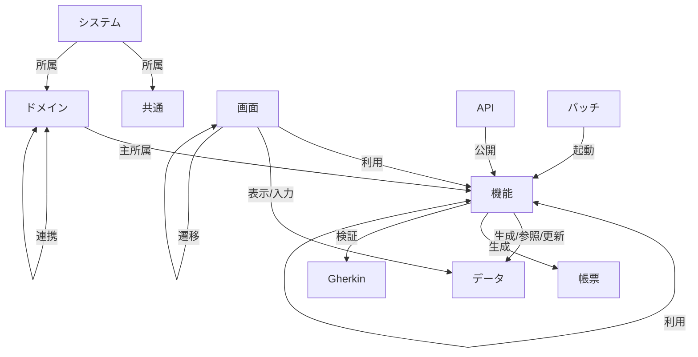

# LLM向けシステム設計ガイドライン

## 1. 目的

本ガイドラインは、LLMを主軸として業務システムを設計・開発する際の、設計資産の分割方法、正本、粒度、関係性、図の扱い、LLMと通常ツールの責務を定める。

目的は、LLMに巨大な設計書を一括して読ませることではない。

**異なる観点の設計情報を意図的に分離し、それらを相互に照合することで、LLMが自身の見落とし・矛盾・不足を発見しやすくすること**を中心目的とする。

---

# 2. 設計原則

## 2.1 責務ごとに分離する

各資料は異なる事実・観点を担当する。同じ情報を複数資料で正本化しない。

## 2.2 正本を明確にする

各情報について「何が正しい情報なのか」を一つにする。補助図・一覧・ビューは正本から生成する。

## 2.3 テキストベースを基本とする

検索、差分管理、LLM参照、機械処理を容易にするため、設計情報は原則としてテキストで管理する。視覚的な配置が仕様そのものである画面レイアウト等はSVGを使用する。

## 2.4 図そのものが仕様である場合は図記述を正本にする

業務フロー、データフロー、状態遷移、画面遷移、処理シーケンスなどはMermaidの宣言的記述を正本とする。

## 2.5 機械変換できるものにはLLMを介在させない

DBML→ER図など、構造が明確な変換はParser/Generator/Rendererで行う。

## 2.6 意味解釈が必要なところにLLMを使う

自然言語からの構造化、業務概念の整理、設計資料間の矛盾検出、影響分析、補助図生成などにLLMを利用する。

## 2.7 所属と関連を分離する

「どこに属するか」と「何と関係するか」は別概念として管理する。

## 2.8 N:Mを前提にする

画面・API・バッチ・帳票と機能を単純な親子関係に固定しない。現実の利用関係に応じてN:Mを許容する。

## 2.9 共通仕様はデフォルト、個別仕様は差分

全画面に共通するUI挙動などは共通仕様として定義し、個別資料では例外・差分だけを記述する。

## 2.10 IDと関係を機械可読にする

設計資産には安定したIDを付与し、他資料から参照できるようにする。関係情報も必要に応じて構造化する。

---

# 3. 基本構造

```text
システム
├─ 共通
└─ ドメイン
   ├─ 受注
   ├─ 在庫
   ├─ 出荷
   └─ 売上
```

## 3.1 共通

特定ドメインに属さず、複数ドメインで共通利用される定義・ルール・基盤・機能などを管理する。

例:

- 用語定義
- 共通ルール
- 共通コード
- 認証・認可
- 共通UI仕様
- 共通機能
- 共通データ

## 3.2 ドメイン

業務上の責務と境界をひとまとまりとして扱う単位。

例:

- 受注
- 在庫
- 出荷
- 入荷
- 売上

「業務領域」「業務」などの似た階層名を併用せず、**ドメイン**に統一する。

## 3.3 業務横断という特殊枠は作らない

複数ドメインにまたがる処理や機能は、専用の「横断ドメイン」に押し込めない。

例えば:

```text
受注．受注確定
  ├─ 利用 → 在庫．在庫引当
  └─ 起動 → 出荷．出荷指示
```

のように、主たる責務を持つドメインに所属させ、他ドメインとの関係を別途表現する。

---

# 4. 機能・実現手段・利用者

## 4.1 機能

機能は「システムが提供する処理・能力」の単位。

例:

- 受注登録
- 受注検索
- 受注確定
- 在庫引当
- 出荷指示

機能には原則として主所属ドメインを持たせる。

## 4.2 実現手段

機能を利用・起動・公開・実行するための手段。

- 画面
- API
- バッチ
- 帳票
- 外部連携
- イベント等

これらを機能の子として固定しない。

## 4.3 利用者

機能や実現手段を利用する主体。

- 業務利用者
- 外部システム
- スケジューラ
- 他の機能・サービス等

利用者と実現手段も混同しない。

---

# 5. 設計資産一覧

下表は、基本的な作成順に近づけた推奨順序である。厳密なウォーターフォール順序ではなく、設計を進める際の主な依存関係を示す。

| 順 | 設計資産 | 基本単位 | 正本 | 正本は図か | 図の扱い | 主な用途 |
|---:|---|---|---|:---:|---|---|
| 1 | **用語定義** | 1用語 | Markdown / YAML | × | 必要に応じて概念図 | 用語・概念の意味を統一 |
| 2 | **ドメイン定義** | 1ドメイン | Markdown | × | 必要に応じて業務概念図 | 責務・境界・対象を定義 |
| 3 | **業務ルール** | 適用範囲 | Markdown | × | 業務フロー等へ反映 | 制約・判断・例外を定義 |
| 4 | **データ定義** | 1データ概念 | Markdown / YAML | × | 必要に応じて概念データ図 | データの意味・粒度・ライフサイクル |
| 5 | **DB構造** | DB / Schema | DBML | × | ER図を自動生成 | 永続化構造 |
| 6 | **業務フロー** | 業務シナリオ | Mermaid `.mmd` | ○ | 正本 | 業務作業・判断・順序 |
| 7 | **データフロー** | データ系統 | Mermaid `.mmd` | ○ | 正本 | データの生成・移動・変換 |
| 8 | **状態遷移** | 状態を持つ対象 | Mermaid `.mmd` | ○ | 正本 | 状態・遷移 |
| 9 | **機能定義** | 1機能 | Markdown / YAML | × | 必要に応じて機能構成図 | システムの能力・責務 |
| 10 | **画面仕様** | 1画面 | YAML / Markdown | × | 構造図・レイアウトを生成/管理 | 利用者から見た操作・表示・構造 |
| 11 | **API仕様** | API | OpenAPI / YAML | × | 必要に応じてAPI構成図 | API契約 |
| 12 | **画面遷移** | 画面グラフ | Mermaid `.mmd` | ○ | 正本 | 画面間の導線 |
| 13 | **処理シーケンス** | 1ユースケース / 処理シナリオ | Mermaid `.mmd` | ○ | 正本 | システム処理の順序 |
| 14 | **振る舞い・受入条件** | 1受入シナリオ | Gherkin | × | 必要なら補助図 | 振る舞い・受入条件 |
| 15 | **実装** | コード | ソースコード | × | 必要に応じて | 設計の実現 |

### 補足

11～13は相互作用が強い。画面仕様、API仕様、画面遷移、処理シーケンスは行き来しながら収束させる。

---

# 6. 用語定義

## 正本

MarkdownまたはYAML。

## 単位

原則1用語。

## 記述内容

- 用語ID
- 正式名称
- 定義
- 別名・略称
- 関連用語
- 混同しやすい用語
- 必要に応じて非推奨表現

「禁止用語」を独立した資料として作らず、必要なら用語の属性として管理する。

---

# 7. ドメイン定義

## 正本

Markdown。

## 単位

**1ドメイン = 1定義**を基本とする。

ドメインが10個あるなら、原則として10個のドメイン定義を持つ。

例:

```text
domains/
├─ order/
│  └─ definition.md
├─ inventory/
│  └─ definition.md
└─ shipment/
   └─ definition.md
```

## 記述内容

- ドメインID
- ドメイン名称
- 目的
- 主な責務
- 主な業務対象
- 責務境界
- 対象外
- 他ドメインとの関係概要

例:

```markdown
# 受注

## 目的
顧客からの注文を受け付け、出荷可能な注文として確定するまでを管理する。

## 主な対象
- 注文
- 注文明細
- 顧客
- 受注状態

## 主な責務
- 注文受付
- 注文内容確認
- 注文確定
- 注文取消

## 対象外
- 在庫数量そのものの管理
- 出荷作業そのもの
```

## 記述しないもの

- 詳細な業務ルール
- テーブル構造
- 画面項目
- API詳細
- 全機能の詳細

ドメイン定義は、**「このドメインは何を担当するか」**に集中させる。

---

# 8. 業務ルール

## 正本

Markdown。

## 単位

ドメイン単位に固定せず、**適用範囲単位**で管理する。

例:

```text
domains/order/rules/
├─ confirmation.md
├─ cancellation.md
└─ pricing.md
```

共通ルールは `common/rules/` などで管理できる。

## 記述内容

- 必須条件
- 禁止事項
- 判断条件
- 計算規則
- 変更条件
- キャンセル条件
- 例外条件
- 前提条件

## ドメイン定義との関係

別資料として管理する。

```text
ドメイン定義
  → 何を担当するか

業務ルール
  → その業務で何が許されるか
```

---

# 9. データ定義

## 正本

MarkdownまたはYAML。

## 単位

原則1データ概念。

例:

```text
data/
├─ customer.md
├─ order.md
├─ order-detail.md
├─ allocation.md
└─ shipment.md
```

## 記述内容

- データID
- 名称
- 業務上の意味
- データ粒度
- 主体
- 生成条件
- 更新条件
- ライフサイクル
- 履歴の扱い
- スナップショットの扱い
- 業務上の関係
- 管理主体

## DB構造との違い

```text
データ定義
  → 業務上「何なのか」

DBML
  → 技術上「どう保存するのか」
```

---

# 10. DB構造

## 正本

DBML。

## 単位

DBまたはSchema。

## 記述内容

- Table
- Column
- Data Type
- PK
- FK
- NULL可否
- UNIQUE
- INDEX
- DB制約

業務上の意味をDBMLに重複して正本化しない。

---

# 11. ER図

ER図はDBMLから直接生成する補助図。

```text
DBML
 ↓
Parser
 ↓
ER図
```

原則としてLLMは介在させない。

---

# 12. 業務フロー

## 正本

Mermaid。

## 単位

業務シナリオ、ユースケース、または業務上意味のある処理単位。

## 記述内容

- 業務作業
- 作業順序
- 判断
- 分岐
- 担当主体
- 開始・終了

コード内部処理、SQL、DOMイベントは記述しない。

---

# 13. データフロー

## 正本

Mermaid。

## 単位

データの生成・移動・変換を表す意味のある単位。

## 記述内容

- データ生成
- データ受渡し
- データ変換
- データ派生
- データ消費

業務フローの単なる言い換えにはしない。

---

# 14. 状態遷移

## 正本

Mermaid。

## 単位

状態を持つ対象。

例:

- 注文
- 出荷
- 在庫引当
- 請求

## 記述内容

- 状態
- 遷移
- 遷移イベント
- 必要に応じて遷移条件

状態の意味や詳細な業務ルールは別正本を参照する。

---

# 15. 機能定義

## 正本

MarkdownまたはYAML。

## 単位

1機能。

## 記述内容

- 機能ID
- 機能名称
- 目的
- 責務
- 主所属ドメイン
- 関連ドメイン
- 入力概要
- 出力概要
- 前提条件
- 成功条件
- 失敗条件

## 記述しないもの

以下を必須項目として機能定義に列挙しない。

- 関連画面
- 関連API
- 関連バッチ
- 関連帳票
- 関連Gherkin

これらは各資産の定義と資産間関係から導出する。

これにより機能定義の二重管理を避ける。

---

# 16. 画面仕様

画面は単なるレイアウトではなく、**利用者から見て何ができるかを定義する外部仕様**とする。

画面仕様は次の観点を持つ。

```text
画面仕様
├─ 画面構造
├─ 画面操作
├─ 画面状態
└─ 画面レイアウト
```

## 16.1 画面構造

### 単位

1画面。

### 記述内容

- 画面ID
- 項目ID
- コンポーネント
- ラベル
- 入力種別
- 表
- ボタン
- ダイアログ
- 構造的グループ

**何が存在するか**を定義する。

## 16.2 画面操作

仕様として、利用者に意味のある操作を定義する。

例:

- 検索
- 登録
- 更新
- 削除
- 確定
- キャンセル
- 明細追加
- 明細削除
- CSV出力

さらに必要に応じて、

- 操作可能条件
- 操作時の処理
- 成功時の結果
- 失敗時の結果
- 確認ダイアログ
- 入力エラー

を定義する。

### 構造化例

```yaml
events:
  - id: confirm
    trigger: confirmButton
    action:
      type: function
      target: FUNC-ORDER-CONFIRM
    success: SCREEN-ORDER-COMPLETE
    failure: showError
```

## 16.3 DOMイベントとの境界

仕様として定義するのは、**利用者から見える操作・振る舞い**。

原則として以下はコード側の責務。

- clickの実装方法
- mouseover
- focus / blur
- keydown
- Angular等のイベントバインディング
- コンポーネント内部イベント

ただし、

> Enterキーで検索できる

> フォーカスアウト時に入力チェックする

など、利用者から見える振る舞いは外部仕様として定義する。

## 16.4 画面状態

- 初期状態
- 表示/非表示条件
- 活性/非活性条件
- 入力可否
- エラー表示
- 処理中表示
- 処理後状態

## 16.5 画面レイアウト

### 正本

SVG。

### 記述内容

- 配置
- サイズ
- 余白
- グループ
- 表示順
- ボタン位置
- 表
- ダイアログ
- 視覚的階層

```text
画面構造
  → 何があるか

画面操作
  → 何ができるか

画面状態
  → どの条件でどうなるか

画面レイアウト
  → どこにどう配置するか
```

---

# 17. API仕様

## 正本

OpenAPI / YAML。

## 単位

API。

## 記述内容

- Endpoint
- HTTP Method
- Request
- Response
- Schema
- Validation
- Status Code
- Error
- Authentication
- Pagination等

業務ルールをAPI仕様に重複して正本化しない。

---

# 18. 画面遷移

## 正本

Mermaid。

## 基本単位

論理的には**画面全体の遷移グラフ**を一つとする。

大規模な場合、物理ファイルは分割してよい。

```text
screen-flow/
├─ overview.mmd
├─ order.mmd
├─ inventory.mmd
└─ shipment.mmd
```

全体図・ドメイン別図・機能別図は正本から生成する。

画面単位の「この画面からどこへ行けるか」は補助ビューとして作れても、正本にはしない。

---

# 19. 処理シーケンス

## 19.1 正本

Mermaid。

## 19.2 単位

1ユースケース / 1処理シナリオ。

例:

- 受注登録
- 受注確定
- 在庫引当
- 出荷指示

## 19.3 対象粒度

コードレベルのメソッド呼び出し順ではない。

基本的には、

```text
利用者
 ↓
画面
 ↓
API
 ↓
業務処理/サービス
 ↓
他サービス・他ドメイン
 ↓
DB
```

程度のシステム設計レベルとする。

## 19.4 DB操作

業務理解に必要な永続化操作は記載する。

例:

```text
受注確定
 ↓
注文を確定状態へ更新
 ↓
在庫引当
 ↓
引当結果登録
```

ただし、すべてのCRUDや内部参照を列挙するものではない。

## 19.5 コードレベルとの境界

記述する:

```text
受注画面
 → 受注API
 → 受注サービス
 → 在庫サービス
 → 注文確定
 → 引当結果登録
```

通常は記述しない:

```text
OrderService.confirm()
 → Validator.validate()
 → Repository.update()
```

後者は実装側の責務。

## 19.6 作成タイミング

基本的には、外部仕様・機能・API等がある程度固まった後、製造前の処理設計として作成する。

ただし、

```text
画面仕様
   ↕
API仕様
   ↕
処理シーケンス
```

は反復して設計する。

処理シーケンスを作成した結果、API不足、画面操作不足、データ不足、ルール不足などが発見されることを前提とする。

---

# 20. 振る舞い・受入条件

## 正本

Gherkin。

## 単位

1受入シナリオ。

## 記述内容

- Feature
- Scenario
- Given
- When
- Then
- Scenario Outline
- 代表的な異常系・境界条件

設計段階での振る舞い定義と、実装後の受入テストの双方に利用する。

---

# 21. 図の分類

## 21.1 正本そのものが図

| 図 | 正本形式 |
|---|---|
| 業務フロー | Mermaid |
| データフロー | Mermaid |
| 状態遷移 | Mermaid |
| 画面遷移 | Mermaid |
| 処理シーケンス | Mermaid |
| 画面レイアウト | SVG |

## 21.2 正本から機械的に生成する補助図

| 正本 | 補助図 | LLM |
|---|---|---|
| DBML | ER図 | 原則不要 |
| OpenAPI | API構成図 | 原則不要 |
| 画面構造 | 画面構造図 | 不要 |
| 資産関係定義 | 設計資産関係図 | 不要 |
| 機能定義の構造化情報 | 機能構成図 | 原則不要 |

基本形:

```text
正本
 ↓
Parser
 ↓
内部モデル
 ↓
Renderer
 ↓
図
```

## 21.3 LLM生成に価値がある補助図

- 業務概念図
- ドメイン関係図
- 概念データ図
- データライフサイクル図
- 業務全体俯瞰図
- 責務境界図

これらは複数の正本をLLMが解釈して生成する補助図であり、正本にはしない。

---

# 22. Mermaid / MMD

Mermaid図を独立ファイルとして管理する場合は、`.mmd` を使用してよい。

```text
.md
→ 文章・複数の設計情報

.mmd
→ Mermaid図そのもの
```

`.mmd` はMarkdown標準の拡張子ではなく、Mermaid記述用として慣例的に利用される形式。

重要なのは拡張子ではなく、正本か生成物かを明確にすることである。

---

# 23. LLMと通常ツールの責務分担

## 23.1 LLMに向くもの

- 自然言語から設計情報への変換
- ドメイン境界の検討
- 業務ルール整理
- データ粒度の検討
- Mermaid生成・修正
- Gherkin生成
- 設計変更
- 矛盾検出
- 不足検出
- 影響範囲分析
- 意味的な図生成

## 23.2 通常ツールに向くもの

- DBML解析
- ER図生成
- OpenAPI検証
- YAML検証
- Mermaidレンダリング
- SVG生成
- ID/参照整合性チェック
- 参照切れ検出
- Gherkin実行
- テスト実行

## 23.3 判断基準

> **意味の解釈が必要か。**

不要なら通常ツール、必要ならLLMを利用する。

---

# 24. 設計資産間の関係

| 関係 | 基本カーディナリティ | 主な意味 |
|---|---:|---|
| システム : ドメイン | 1 : N | 所属 |
| ドメイン : 機能 | 1 : Nを基本 | 主所属 |
| ドメイン : ドメイン | N : M | 連携 |
| 機能 : 機能 | N : M | 利用・依存 |
| 機能 : 画面 | N : M | 利用 |
| 機能 : API | N : M | 公開・利用 |
| 機能 : バッチ | N : M | 起動・実行 |
| 機能 : 帳票 | N : M | 生成・出力 |
| 機能 : データ | N : M | 参照・生成・更新・削除 |
| 画面 : API | N : M | 利用 |
| 画面 : データ | N : M | 表示・入力・編集 |
| API : データ | N : M | 参照・生成・更新 |
| バッチ : データ | N : M | 参照・生成・更新 |
| 帳票 : データ | N : M | 参照・出力 |
| 画面 : 画面 | N : M | 遷移 |
| 機能 : Gherkin | 1 : Nを基本 | 検証 |

カーディナリティは絶対的な制約ではなく、実際の設計に応じて定義する。

---

# 25. 所属と関連の管理

基本的な所属は、

```text
システム → ドメイン → 機能
```

とする。

その他は意味的な関連として扱う。

例:

```text
画面 ──利用──→ 機能
API ──公開──→ 機能
バッチ ──起動──→ 機能
機能 ──利用──→ 機能
機能 ──参照──→ データ
機能 ──生成──→ データ
機能 ──更新──→ データ
機能 ──生成──→ 帳票
画面 ──遷移──→ 画面
ドメイン ──連携──→ ドメイン
Gherkin ──検証──→ 機能
```

---

# 26. 設計資産ID

各資産には安定したIDを付与する。

例:

```text
DOMAIN-ORDER
FUNC-ORDER-CONFIRM
SCREEN-ORDER-DETAIL
API-ORDER-CONFIRM
DATA-ORDER
RULE-ORDER-CONFIRM
AC-ORDER-CONFIRM-001
```

これにより、LLMとツールが設計資産を直接参照できる。

---

# 27. 関係情報を二重管理しない

例えば、

```text
機能定義
  関連画面 = SCREEN-001

画面定義
  関連機能 = FUNC-001
```

の双方を人間が正本として維持すると、変更漏れが発生しやすい。

したがって、次のどちらかにする。

1. 一方を正本として他方を導出する。
2. 関係定義を独立した構造として正本化する。

また、正本から機械的に取得できる関係は自動抽出する。

---

# 28. 設計資産関係図

設計資産全体の関係を把握するための補助図を持つ価値が高い。

ただし、図そのものを正本にはしない。



この図は、資産関係定義から自動生成する。

---

# 29. 相互整合性検証

## 29.1 用語

```text
用語定義 ↔ ドメイン定義
```

確認項目:

- 同じ用語が同じ意味で使われているか
- 類似概念を混同していないか

## 29.2 業務

```text
ドメイン定義
 ↕
業務ルール
 ↕
業務フロー
 ↕
状態遷移
```

確認項目:

- 責務境界とフローが一致するか
- 業務ルールとフローが矛盾しないか
- 状態遷移に不可能な遷移がないか

## 29.3 データ

```text
データ定義
 ↕
DBML
 ↕
データフロー
```

確認項目:

- 必要なデータを保存できるか
- データ粒度とDB構造が矛盾しないか
- データフローに必要なデータが存在するか

## 29.4 機能・UI・API

```text
機能定義
 ↕
画面仕様
 ↕
API仕様
 ↕
処理シーケンス
 ↕
Gherkin
```

確認項目:

- 画面操作に対応する機能があるか
- 必要なAPIが存在するか
- 処理シーケンスが成立するか
- Gherkinが重要な振る舞いを検証しているか

---

# 30. 具体的な矛盾検出例

## 30.1 データ定義とDBML

データ定義:

> 注文確定時の商品単価を保持する。

DBML:

> 注文明細に単価を保持する列が存在しない。

→ 永続化構造上の不足。

## 30.2 業務ルールと状態遷移

業務ルール:

> 出荷済み注文は変更できない。

状態遷移:

> SHIPPED → MODIFIED

→ 矛盾。

## 30.3 画面操作と機能

画面:

> 「受注確定」操作が存在する。

機能定義:

> 受注確定機能が存在しない。

→ 機能不足。

## 30.4 APIと機能

API:

> POST /orders/{id}/confirm

機能:

> 受注確定

→ 対応関係を確認する。

## 30.5 処理シーケンスとデータ

処理シーケンス:

> 引当結果を保存する。

DBML:

> 引当結果を保存できる構造がない。

→ DB構造不足。

---

# 31. 共通仕様

共通仕様は、個別資料の重複を減らすために利用する。

例:

```text
common/specifications/
├─ ui.md
├─ error-handling.md
├─ pagination.md
└─ authorization.md
```

共通仕様がある場合、個別画面・個別機能では標準動作を繰り返し書かず、差分だけを記述する。

例えば、

> 全画面で二重送信を防止する。

が共通仕様なら、個別画面で毎回「二重送信防止」と書かない。

個別画面で異なる場合だけ、例外を記述する。

---

# 32. 画面遷移の管理

画面遷移は論理的には一つのグラフとして管理する。

大規模システムでは物理的に分割してよい。

```text
screen-flow/
├─ overview.mmd
├─ order.mmd
├─ inventory.mmd
└─ shipment.mmd
```

全体図・ドメイン別図・機能別図は、正本から生成する。

画面単位の遷移一覧を補助ビューとして表示することは可能だが、複数箇所で同じ遷移関係を正本化しない。

---

# 33. 設計資料を増やしすぎない基準

新しい資料を作る前に、以下を確認する。

1. 既存資料と責務が明確に異なるか。
2. 新しい正本が本当に必要か。
3. 既存正本から自動生成できないか。
4. 同じ情報を二重管理しないか。
5. LLMによる参照・検証価値があるか。
6. 人間が見ても資料の役割を説明できるか。

特に「○○一覧」「○○対応表」「○○関係図」は、既存資産から生成できないかを先に検討する。

---

# 34. 推奨ディレクトリ構成

一例:

```text
design/
├─ common/
│  ├─ glossary/
│  ├─ rules/
│  └─ specifications/
│
├─ domains/
│  ├─ order/
│  │  ├─ definition.md
│  │  ├─ rules/
│  │  ├─ flows/
│  │  ├─ states/
│  │  ├─ data/
│  │  └─ functions/
│  ├─ inventory/
│  └─ shipment/
│
├─ database/
│  └─ schema.dbml
│
├─ screens/
│  ├─ order-list/
│  │  ├─ structure.yaml
│  │  ├─ interactions.yaml
│  │  └─ layout.svg
│  └─ order-detail/
│
├─ api/
│  └─ openapi.yaml
│
├─ flows/
│  └─ screen-flow.mmd
│
├─ sequences/
│  ├─ order-confirm.mmd
│  └─ shipment-create.mmd
│
└─ tests/
   └─ features/
```

規模に応じてファイルを統合・分割してよい。重要なのは物理配置より正本と責務である。

---

# 35. 採用しない構成

## 35.1 「業務領域」と「業務」を併用する

名称の重複が大きいため採用しない。**ドメイン**に統一する。

## 35.2 「業務横断」という特殊ドメインを作る

複数ドメインにまたがることは所属ではなく関連として表現する。

## 35.3 画面・API・バッチ・帳票を機能の固定的な子にする

実際の関係はN:Mになり得るため、関連として扱う。

## 35.4 機能定義に関連資産一覧を毎回書く

二重管理になりやすいため、関係情報から導出する。

## 35.5 低レベルDOMイベントをすべて外部仕様にする

利用者に意味のある操作・振る舞いを仕様化し、実装詳細はコード側に任せる。

## 35.6 すべてのDB CRUDを処理シーケンスに書く

業務理解に必要な永続化操作だけを書く。

## 35.7 画面遷移を画面ごとに別々の正本にする

論理的には一つのグラフとして管理する。

---

# 36. 最終的な設計思想

```text
                    設計正本群
                        │
        ┌───────────────┼────────────────┐
        ▼               ▼                ▼
     機械変換          LLM解釈          相互検証
        │               │                │
        ▼               ▼                ▼
      補助図         構造化・図         矛盾・不足
        │               │                │
        └───────────────┼────────────────┘
                        ▼
                    実装・テスト
```

LLMは単に「設計書を書いてコードを書く主体」ではない。

以下を行う中心的な推論主体として位置付ける。

- 設計情報を生成・更新する
- 複数の設計観点を比較する
- 矛盾を発見する
- 抜け漏れを発見する
- 影響範囲を分析する
- 補助図を生成する
- 必要な修正を行う

一方、構造的・機械的な処理は通常ツールに任せる。

---

# 37. 最終原則

本方式を一言で表すなら、

> **設計情報を責務ごとに分離し、それぞれに適切な正本形式を与え、IDと関係によって結び付け、LLMによる意味的な検証と通常ツールによる機械的な検証を組み合わせる。**

最終的な目的は資料を増やすことではない。

```text
何が正しい情報か
        ↓
どの資料がそれを決めるか
        ↓
他の資料とどう関係するか
        ↓
変更したとき何が影響を受けるか
        ↓
LLMが矛盾・不足を発見できるか
```

を明確にすることである。

そして、LLM主軸開発では、

```text
設計
 ↓
相互参照
 ↓
矛盾検出
 ↓
不足検出
 ↓
修正
 ↓
再検証
 ↓
実装
```

というループを継続する。

これを本ガイドラインにおけるLLM主軸システム設計の基本形とする。
